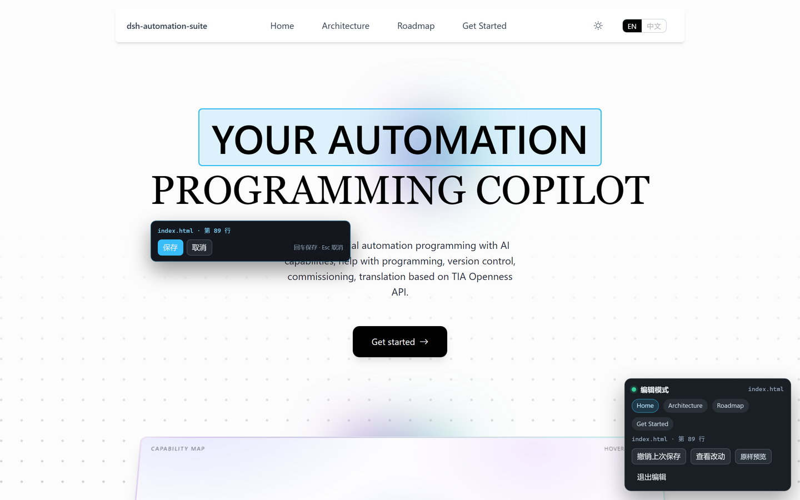

# site-editor — 在浏览器里改文案，直接写回源文件

`site/` 是纯静态站点：首页文案在 `index.html`，子页英文/中文在 `assets/main.js` 的 `I18N`
字典里，架构页还有一部分由 `assets/arch.js` 的数据（`COMPONENTS` / `PRESETS` / `GROUPS`）渲染。
直接改 HTML 不直观，而这个服务器让你**在真实页面里点着字改**：改完按回车，改动就精确落到对应
源文件的对应位置，其余字节一个不动。

```powershell
node tools/site-editor/server.mjs        # 自动打开 http://127.0.0.1:4173/
```

也可以双击 `start.cmd`。常用参数：

| 参数 | 作用 |
|---|---|
| `--port 4174` | 指定端口（被占用时自动往后找） |
| `--site <dir>` | 换一个站点目录（默认仓库里的 `site/`） |
| `--no-open` | 只起服务，不自动开浏览器 |
| `--help` | 用法 |

页面地址加 `?plain=1` 可看不带编辑层的原样页面（悬浮栏的「原样预览」就是这个）。



## 怎么用

1. 页面上鼠标移到文字上会出现**虚线框**，底部悬浮栏右侧显示这段文字来自哪个文件（`index.html · 第 89 行`、
   `assets/main.js · zh · arch.head.title1`、`assets/arch.js · COMPONENTS[3.role.zh]`）。
2. 点一下就地编辑。**回车保存**（Ctrl/⌘+Enter 同效），**Esc 取消**，点页面别处也会保存。
3. 保存后：HTML 文本直接改在 DOM 里立刻可见；字典里的文案（子页中文/英文、架构页段落）
   会刷新一次页面，让站点自己的 `main.js` 重新渲染。
4. 悬浮栏可以：切换四个页面、切换 EN/中文、**撤销上次保存**、**查看改动**（`git diff site/`）、
   **原样预览**（新标签打开 `?plain=1`，不注入任何编辑层，页面与线上完全一致）、退出编辑。
5. 编辑模式下点链接会进入编辑（链接文字也是文案）；要真的跳转请 **Ctrl+点击**（新标签打开），
   或用悬浮栏里的页面按钮。按钮、下拉框等控件保持原来的点击行为，其文字不进入编辑。

## 改的是哪儿

| 页面上的文字 | 实际写入 |
|---|---|
| 首页全部文案 | `site/index.html` 里对应文本节点 |
| 子页正文（中/英） | `site/assets/main.js` 的 `I18N.en` / `I18N.zh` 里对应键的字符串 |
| 架构页段落、卡片、首页五段式说明 | `site/assets/arch.js` 的 `I18N`（被 `main.js` 合并渲染） |
| 架构页组件表 / preset 矩阵 / 分组标题 | `site/assets/arch.js` 的 `COMPONENTS` / `PRESETS` / `GROUPS` 字段 |
| 子页里没有 `data-block` 的英文（如 `01 · BUNDLE`、代码块） | 对应 `index.html` 文本节点 |

## 为什么不会写坏文件

- **只改一个区间**：服务端扫描源文本得到每个文本节点的 `[start, end)`，保存时只替换这一段，
  属性、缩进、注释、CRLF（架构页是 CRLF）全部原样保留。
- **先核对再写**：请求里带「这段文字原来是什么」，服务端发现对不上（文件被别处改过、页面过期）
  就返回 409 并提示刷新，绝不盲写。
- **不引入依赖、不改站点代码**：标记是注入到 HTTP 响应里的 HTML 注释（`<!--dsh-e12-89-->`），
  磁盘上的 HTML 永远没有它们；编辑器自身零依赖。
- **本机专用**：只监听 `127.0.0.1`，每次启动生成一次性 token 注入页面，写接口校验 token 与同源；
  `fs.watch` 发现文件被别处改动会让已打开的页面自动刷新（正在编辑时只提示，不打断）。

写坏了还有三道退路：页面上的「撤销上次保存」（内存里保留最近 40 次）、`git diff site/`
（悬浮栏「查看改动」）、`git checkout -- site/`。

## 边界（刻意没做）

- **按钮/输入框里的文字**不进入编辑，保证这些控件仍可点。要改这类文案，改对应字典键。
- `<title>`、`<meta description>` 不参与就地编辑（它们在 `<head>`，且子页由 `main.js` 的
  `META` 覆盖）；需要时直接改 `index.html` 或 `main.js`。
- 子页英文改的是 `main.js` 的字典；HTML 里给无脚本场景兜底的英文原文不会同步（不影响正常浏览，
  只影响禁用 JS / 爬虫读到的回退文案）。
- `content.md` 是子页英文底稿，工具不会自动同步它；改了英文正文后需要手动回写。
- 首页「Try prompts」演示里的对话文字由 `components.js` 运行时生成，不在可编辑范围内。

## 验收

`test/smoke.py` 是可选的真实浏览器冒烟测试（Python Playwright，本机已装）。它**只写副本**：

```powershell
# 1. 起两个服务：真站点（只读用）+ 副本（写测试用）
node tools/site-editor/server.mjs --port 4187 --no-open
Copy-Item -Recurse site "$env:TEMP\site-edit-test\site"
node tools/site-editor/server.mjs --site "$env:TEMP\site-edit-test\site" --port 4188 --no-open

# 2. 跑
$env:PYTHONIOENCODING='utf-8'
& "C:\Users\Ansel\AppData\Local\Programs\Python\Python313\python.exe" -X utf8 tools/site-editor/test/smoke.py
```

覆盖：注入与悬浮、HTML 就地保存 + 刷新后仍在、撤销、子页中文字典（`arch.js`）、架构页多段字典值、
组件表单元格、CRLF 页面保存后行尾不变、代码块可编辑、Ctrl+点击开新标签、`git diff` 接口、控制台无报错。

## 文件

```
server.mjs        静态服务 + 标记注入 + /__edit/{manifest,save,undo,diff,events}
lib/html.mjs      保源 HTML 文本扫描、实体解码/编码、标记、单区间替换
lib/jsobj.mjs     定位 assets/*.js 里对象字面量的字符串字面量，并按文本 run 改写
public/editor.js  就地编辑 UI（悬浮、会话、保存、撤销、diff、语言切换）
public/editor.css 悬浮栏 / 面板 / toast / 弹窗样式
```
